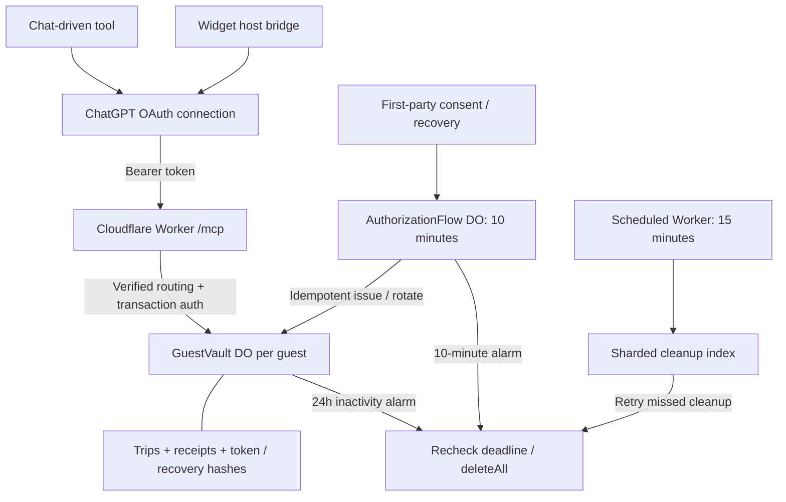

# Durable guest Basket Wise

This is the Cloudflare production-design adapter, separate from the private local
app, the existing stateless guest Worker, and `poc/guest-oauth`. No existing entry
point, manifest, package version, database, or local-app deployment configuration is changed.
It reuses the existing domain calculation code read-only. Its independently
versioned source package is `basket-wise-cloudflare` 0.5.3. This latest patch adds
the reviewer walkthrough URL; the deployed Worker and widget resources remain 0.5.0.
See [the shopping-list design](SHOPPING-LIST.md)
for the account-wise list, atomic trip transfer and separate widget. The list
survives basket cleanup and has the profile's 90-day inactivity lifecycle.
Preparatory data reads no longer open a widget. Explicit `open_basket` calls
now use the existing OAuth connection and return the saved basket directly;
there is no additional Connect or Load step. They require a fresh `activityId`
(reused on retry). Passive rendering of a saved widget still makes no reads or
retention extensions. Reconnect is shown only after an authorization challenge.
The 0.5.0 runtime was deployed with `cf` to the existing service on October 10, 2026.
Public smoke passed, including the new protected-open contract and byte-identical
current/cached widget resources. The developer-platform draft is now v0.5.3;
the prior 18-tool catalog is unchanged. Actual phone-host rendering remains a
separate manual check.

The compact widget collapses
the basket's item list by default and prominently shows reached/next milestones and
eligible-subtotal progress. This UI release was deployed with `cf` on October 10, 2026.
The preceding release removes food
expiry/consumption tracking and includes the previously local threshold features.
See the deployment log for previously deployed versions and live verification.

Threshold configuration now supports unlimited multiples and finite combinations
with quantities, plus an advisory `suggest_removals` tool. See
[threshold behavior and examples](THRESHOLDS.md). Existing independent milestone
lists retain their meaning until explicitly replaced.

Food packaging dates and consumption status are no longer accepted or displayed
by this adapter. Old stored fields and mutation receipts are projected out of
tool results; legacy storage still follows the existing 24-hour basket cleanup.
The separate 24-hour basket and 90-day inactive-profile rules are unchanged.

The isolated service was deployed with `cf` on October 10, 2026 at
`https://basketwise.loudcoder.com`. Version 0.1.1 fixes recovery-before-acknowledgement
lockout and enables guest enrollment. See [the deployment runbook](deploy/README.md)
for the release record and the separate live-protocol versus ChatGPT-host checks.

## Run local verification

From the repository root, with its existing dependencies installed:

```sh
npm run check --prefix cloudflare
npm run check
```

The adapter builds its self-contained widget and Worker into ignored
`cloudflare/dist/`. Tests use the real local workerd/Miniflare runtime and SQLite
Durable Objects, isolated temporary storage, ephemeral **loopback-only** listeners,
disabled telemetry, and an outbound-network-denying service. Storage inspection
and expiry manipulation exist only in the local test harness, not Worker routes.
Tests remove their temporary database directories and stop the runtime.

The browser regression test uses an installed Chrome/Chromium (or `CHROME_BIN`),
a disposable profile, and local workerd responses intercepted through CDP. The
ChatGPT callback is fulfilled inside the test; no request reaches ChatGPT or any
other external destination. It covers enrollment, recovery, cancellation, and
CSP rejection of an unregistered form destination. This test is reported as
skipped when no local Chromium executable is available; no browser is downloaded.

## Public information pages

The source includes a responsive website, support guide, privacy policy, and
terms at `/`, `/support`, `/privacy`, and `/terms`. They are informational only:
no guest storage access, OAuth flow creation, forms, tracking, external scripts,
or changes to retention. Styles and the Basket Wise icon are served locally.

Preview them with `npm run preview:pages --prefix cloudflare`. The loopback-only
preview is visibly unpublished and contains no actionable placeholder contact.
It uses no OAuth credentials, guest data, or production bindings. Stop it with
Ctrl-C when finished.

Production rendering requires both `PUBLIC_PAGES_ENABLED=true` and a valid
publisher-provided `PUBLIC_CONTACT` email address or absolute HTTPS support-form
URL. Configure the publisher's approved contact in the ignored local deployment
configuration. Without those settings, the existing minimal home page is preserved
and the new routes stay closed. All four live pages, links, contact, GET/HEAD
responses, assets, and security headers were checked on October 10, 2026.

## Architecture and trust boundaries

- A public Worker handles metadata, first-party OAuth consent/recovery forms,
  token exchange, and stateless MCP transport. No background widget polling.
- `AuthorizationFlow`: one short-lived SQLite object per OAuth interaction.
  Stores the original request (including ChatGPT's unchanged `state`), browser and
  CSRF hashes, bound decision, and idempotent issuance progress. Expires in 10 minutes.
- `GuestVault`: one SQLite object per anonymous guest space, with multiple trips,
  authoritative revisions, persistent operation/read receipts, credential hashes,
  client/resource/scope-bound grants, and recovery-key hash. No global guest store.
- `CleanupIndex`: 16 fixed shards containing only object locators/type/deadlines.
  Register before provisioning durable data. The scheduled handler sweeps bounded
  oldest-first batches; failed cleanup is backed off without discarding the entry.
- Objects are private bindings, never publicly addressed RPC endpoints. Only
  server-verified, signed routing handles select a vault. A locator/spaceId/tripId
  alone is not authorization. The Worker never uses caller-supplied owner IDs.

Authentication is checked again inside the same synchronous SQLite transaction
as a mutation, revision change, and idempotency receipt. Pure asynchronous domain
calculation happens before that transaction; the transaction rejects a changed
revision or revoked credential before writing. Equal mutation retries return the
original result; a reused ID with different normalized input is rejected.

Widget `callServerTool` and model `tools/call` reach **the same** individually
exposed OAuth-protected operation tools. They share the existing GuestVault
authorization and transaction path. The widget only retains non-secret display
state in memory. Tool output
contains a non-authorizing presentation `spaceId`, never credential material.

## Independent basket and profile lifetimes (v0.2.0)

Shopping data expires at `last successful new foreground basket action + 24h`.
The anonymous profile expires at that activity time `+ 90 days` (or enrollment
time when unused). Both clocks are stored in the same GuestVault transaction.
Successful reads require a fresh `activityId`; mutations require `operationId`,
`expectedRevision` and `dataEpoch` from a fresh read. Identical retries do not
renew either clock. Profile lookup, discovery, OAuth refresh, recovery, opening
the widget and failed requests do not count as activity. No background polling.
Human intent is a client contract, not something the server can independently prove.

At the basket cutoff, access checks, alarms and the safety sweep purge all trips,
the current pointer, and stored shopping-result receipts. The revision advances
and a new random data epoch invalidates every old mutation. Minimal replay
hashes remain until their 90-day deadline so delayed reads cannot renew activity
or restore data. `get_basket` returns an empty space using the existing connection;
`get_profile` returns the same stable opaque ID without renewing either clock.
Only the 90-day profile cutoff or explicit `delete_guest` uses `deleteAll()`.
`clear_baskets` removes shopping data but preserves identity and credentials;
its minimal persistent receipt prevents a retry from clearing newer baskets.
Empty constructors and stale credentials never initialize a new profile.

Cutoffs are enforced before access even if physical cleanup is delayed. Recovery
can reconnect an empty, unexpired profile but cannot restore purged baskets.
Cloudflare SQLite PITR can retain historical database states for 30 days; this
application exposes no restore path. Cleanup entries disappear after profile
deletion; fixed shard tables contain no shopping data.

Legacy profiles alive at the fixed policy boundary, October 10, 2026 at
17:17:26 UTC, migrate lazily: retain their original basket deadline and derive
the profile deadline from their last recorded activity plus 90 days. Previously
expired or deleted profiles are not revived. Existing refresh records migrate
to at most that profile deadline. The cutoff constant must never be advanced.
Access tokens remain 10 minutes; rotating refresh tokens last at most 90 days
and never beyond the current profile deadline. Refresh does not keep a profile alive.

Refresh the connection's tool definitions after upgrading: mutation inputs now
require `dataEpoch`. Existing resource aliases load the new widget. An old
schema or cached snapshot fails closed; never remove epoch validation as a
compatibility workaround. Server support for the documented profile tool does
not guarantee ChatGPT account-switching eligibility.

## OAuth and recovery

The v0.1.7 guest-access pages use a responsive, first-party design for choosing
a new space, entering a recovery key, and privately acknowledging a saved key.
Recovery is a native expandable section; all actions remain native forms and
require no JavaScript. Styles and the icon load only from `/auth.css` and
`/auth-icon.svg`. Only OAuth HTML responses permit these same-origin styles and
images; scripts, inline styles, framing, and unregistered form destinations
remain blocked. Browser errors receive a styled generic explanation without
reflecting submitted fields; API clients retain the JSON error contract.

Use `npm run preview:auth --prefix cloudflare` for a loopback-only, visibly
labeled design preview, with `/saved` and `/recovered` showing an invalid sample
key. It has no bindings, credentials, guest state, or functioning form handlers.
The existing v0.1.6 widget URI and bundle are deliberately retained; this page
redesign does not refresh the ChatGPT connection or repair older cached widgets.

No signup/email/password. Consent explicitly selects new space or recovery.
Confidential OAuth clients, authorization-code + S256 PKCE, exact registered
redirects, exact resource and scope, browser-bound CSRF, no query-string tokens,
no CIMD or third-party identity provider. Constrained ChatGPT DCR and its client
registry limits are documented in [DCR.md](DCR.md). The authorization code starts its
60-second redemption window only after the user saves the recovery key and
continues. Access tokens last at most 10 minutes or the inactivity deadline,
whichever is sooner. Refresh tokens rotate, have a 30-day absolute lifetime per
issuance, and never override the inactivity deadline. Code/refresh reuse revokes
their grant. Expired credential hashes have a one-day replay-detection grace
before opportunistic pruning; receipts remain for the life of the guest.

OAuth form pages and their redirects allow only the already validated callback
origin in `form-action`, alongside `'self'`, so browser CSP checks do not block
the OAuth redirect. Exact callback-URL validation is unchanged. Other responses
retain the same-origin-only form policy; scripts, framing, and base-URL overrides
remain disabled. OAuth pages use `Referrer-Policy: same-origin` so browser form
POSTs preserve their origin for CSRF validation; cross-origin callbacks still
receive no referrer. Other responses retain `no-referrer`.

A 256-bit-secret recovery capability is entered **only on the first-party form**.
Submitting it only validates the old key and displays a deterministic replacement;
the vault is not changed. Losing or abandoning this page, even after its flow
expires, leaves the old key and connections usable until normal guest expiry.
Only after the user acknowledges saving the replacement does one vault transaction
revalidate the old key, rotate recovery, revoke earlier grants, record issuance,
and activate the authorization code. Trips, revisions, and the inactivity deadline
are preserved. Concurrent prepared recoveries cannot both commit. Retrying a lost
acknowledgement response never resets code expiry or reactivates a revoked grant;
the saved replacement key also works in a fresh recovery flow if the old flow is lost.
No recovery key is sent to tools, widget state, logs, or the model. Repeated consent is idempotent,
with codes/recovery secrets derived using domain-separated keyed HMACs rather
than stored as plaintext. Losing the key and every connection means losing access.

Cross-object provisioning is not a distributed transaction: the flow holds its
bound decision, the vault records issuance by flow ID, and the cleanup index is
registered first. Retrying resumes that same issuance. A lost response is not
permission to create a second guest. If storage cleanup or a final response fails,
safe retries remain possible; token-rotation response loss may require recovery.

## Limits and deployment configuration

The legacy `wrangler.jsonc` is a source-only reference with no route or secrets.
**Do not use it to deploy over this service.** The active, isolated `cf` deployment
configuration is in the ignored `deploy/cloudflare.config.ts`. Start from
`deploy/cloudflare.config.example.ts` for a new installation; see
[public deployment setup](deploy/PUBLIC-README.md). Deployment requires:

- A dedicated HTTPS origin/route, set as `PUBLIC_ORIGIN`.
- `CLIENT_ID`, exact HTTPS redirects in JSON `REDIRECT_URIS`, and deliberate
  enrollment activation (`ENROLLMENT_ENABLED=true` in the current deployment;
  missing or false still fails closed).
- Secret bindings `CLIENT_SECRET` (at least 32 chars) and `ROOT_KEY` (at least 43
  chars, generated randomly). Root-key replacement invalidates all capabilities;
  do not casually rotate it or reuse keys across environments.
- The three SQLite-backed object namespaces/migration, rate-limit binding, and
  15-minute scheduled trigger. Missing rate limiting fails closed.
- Review origin redirects, credential storage, Cloudflare plan/limits, backup
  retention, abuse controls, key management, and operator access before launch.

Bounds: 100 trips, 50 lines per trip, 10,000 combined operation/read receipts,
256 connection grants, 4,096 access/refresh credential rows per guest, 96 KiB MCP
requests, 12 KiB forms, and 10,000 cleanup entries per shard. Exceeding a limit
rejects new work instead of evicting idempotency history. Credentials are pruned
during collection; busy guests hitting a cap must recover/start fresh as appropriate.
There are no custom request/body logs, telemetry, remote model calls, photo storage,
KV/D1/R2 dependencies, admin endpoints, or automatic local-data upload.

The initial widget supports load/retry, start trip (EUR), add item, and confirmed
guest deletion. Other existing domain actions are available through the protected
tool. This is not a promise of full UI parity with the private local app.

### Local widget layout preview

`npm run preview:widget --prefix cloudflare` builds the actual self-contained
widget and serves it on loopback inside an explicitly labeled sample host.
The sample host keeps synthetic data only in browser memory. It has no OAuth,
remote requests, or persisted guest data. Use its light/dark toggle and resize
the window to inspect narrow layouts. Close the process when finished.

Source v0.1.6 replaces raw JSON with totals and item rows, collapses add-item
entry until requested, uses the host's theme variables, and keeps touch controls
at least 44 pixels high. Prices are entered in the displayed currency, converted
to integer minor units without rounding. Form actions use the existing host
bridge even when native form submission is sandbox-blocked. OAuth, retention,
and server-side basket semantics are unchanged.

Source v0.1.8 matches the guest-access pages with cream/forest-green surfaces,
serif headings and totals, an inline Basket Wise mark, and coordinated dark mode.
Entry fields stack on phones, visible controls are at least 48 pixels high, and
input text stays at least 16 pixels. The widget remains self-contained with no
external fonts, images, scripts, or new network requests. The current resource
is `ui://basket-wise-durable/v0.1.8/basket.html`; exact v0.1.5 and v0.1.6 aliases
serve the same bundle so older cached tool metadata does not cause missing assets.
Refresh tools on the existing ChatGPT connection and use a new conversation to
pick up the canonical resource; no reinstall or new OAuth identity is needed.

The browser tests use a disposable Chrome profile, not your personal profile.
They require loopback/process permissions; a sandbox startup failure is not a
test pass. The v0.1.8 verification reran outside the restricted sandbox and all
59 adapter tests passed. UI screenshots use labeled, in-memory sample data,
not a live ChatGPT session or stored baskets.

## Release gates not established by local tests

Real ChatGPT OAuth guest enrollment, refresh/reconnect UI, mobile behavior, and
both model/widget calls with the actual host must still be tested after approved
enrollment activation. There is no browser/device-cookie reconnection convenience
in this version; use a retained connection or recovery key. No cloud resources,
tunnel, deployment, DNS change, ChatGPT connection, or data migration is performed
by building or testing this adapter.


